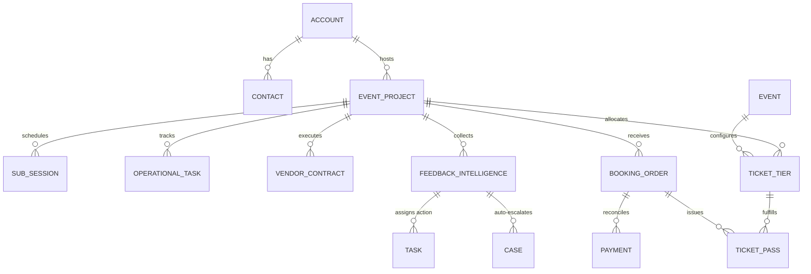
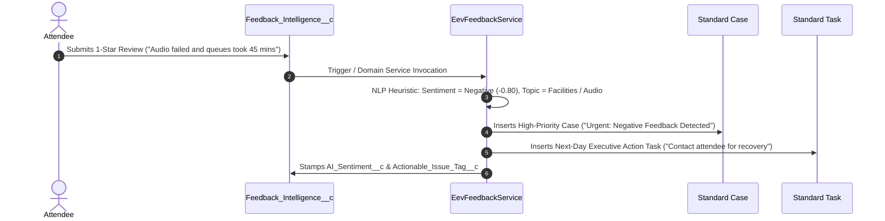

# EpicEventz 360: Technical System Manual & Interview Defense Guide

> **Author:** EpicEventz Development Team  
> **Repository:** [https://github.com/des2yapath/EpicEventz](https://github.com/des2yapath/EpicEventz)  
> **Target Org:** Salesforce Core (Developer Edition / Scratch Org / Sandbox)  
> **Version:** 1.0 (Production Release)

---

## Table of Contents
1. [Executive Summary & Problem Statement](#1-executive-summary--problem-statement)
2. [Domain Architecture & Relational Topology](#2-domain-architecture--relational-topology)
3. [How the Platform Works: End-to-End Capabilities](#3-how-the-platform-works-end-to-end-capabilities)
   - [Front-of-House (Attendee & Gate Operations)](#front-of-house-attendee--gate-operations)
   - [Back-of-House (Event Production Operations)](#back-of-house-event-production-operations)
   - [Autonomous "Hero" Recovery Loop](#autonomous-hero-recovery-loop)
   - [Headless Apex REST Engine](#headless-apex-rest-engine)
4. [Under-the-Hood Engineering Architecture](#4-under-the-hood-engineering-architecture)
   - [Pattern 1: Concurrency Control via Compare-and-Swap (CAS)](#pattern-1-concurrency-control-via-compare-and-swap-cas)
   - [Pattern 2: Distributed Idempotency & Replay Protection](#pattern-2-distributed-idempotency--replay-protection)
   - [Pattern 3: Gate Anti-Duplication Cryptographic Tokens](#pattern-3-gate-anti-duplication-cryptographic-tokens)
   - [Pattern 4: Self-Healing Nightly Reconciliation Batch](#pattern-4-self-healing-nightly-reconciliation-batch)
   - [Pattern 5: Zero-PII Structured Observability](#pattern-5-zero-pii-structured-observability)
5. [The Ultimate Interview Defense Guide (10 Tough Technical Questions)](#5-the-ultimate-interview-defense-guide-10-tough-technical-questions)
6. [3-Minute Live Demo Script for Judges](#6-3-minute-live-demo-script-for-judges)

---

## 1. Executive Summary & Problem Statement

### The Event Industry Dilemma
Live event operations suffer from severe architectural fragmentation:
* **Front-of-House (Ticketing & Fans):** High-velocity, burst-traffic ticket sales (e.g., flash sales, festival drops) running on external ticketing engines that frequently oversell, crash under race conditions, or fail when attendees scan duplicated screenshot barcodes at the turnstile.
* **Back-of-House (Logistics & Production):** Vendor contracts, budget allocations, stage sub-sessions, and security run-sheets managed in fragmented spreadsheets or siloed ERPs.
* **Customer Retention (The Service Gap):** Disgruntled attendees leaving negative reviews on social media with zero automated service recovery mechanism from the organizer.

### The EpicEventz 360 Solution
EpicEventz 360 solves this on **Salesforce Core**:
1. **Sub-second Discovery & Gate Check-in:** Custom Lightning Web Components (`eventExplorer`, `checkinConsole`) with debounced SOSL search, dynamic price floors, and double-entry gate validation.
2. **Enterprise Operations Suite:** Comprehensive operational tracking across `Event_Project__c`, `Vendor_Contract__c`, `Operational_Task__c`, and `Sub_Session__c` with automated rollups and budget variance calculations.
3. **Atomic Concurrency & Money Ledgering:** Compare-and-Swap (CAS) optimistic locking preventing overselling, paired with idempotent transaction logging (`Payment__c`, `Booking_Order__c`).
4. **Autonomous AI Service Recovery Loop:** Automatic natural language sentiment classification of 1–2★ feedback triggering high-priority `Case` creation and next-day executive `Task` assignment.
5. **Production Self-Healing:** Nightly batch auditing reconciling issued passes against inventory counters.

---

## 2. Domain Architecture & Relational Topology

EpicEventz leverages a normalized schema balancing declarative rollup power with transactional performance:



### Relational Design Decisions
| Object | Relationship Type | Parent | Technical Rationale |
| :--- | :--- | :--- | :--- |
| `Ticket_Tier__c` | **Master-Detail** | `Event_Project__c` | Enforces cascade delete, strict inheritance of security, and enables declarative rollups (`SUM(Allocated__c)`). |
| `Ticket_Tier__c` | **Master-Detail** | `Event__c` | Multi-parent master-detail linking public marketing catalog events to operational projects. |
| `Booking_Order__c` | **Lookup** | `Event_Project__c` | Prevents record lock contention on the parent project during mass concurrent checkout spikes. |
| `Ticket_Pass__c` | **Lookup** | `Booking_Order__c` | Individual attendee passes are independently stateful (valid, checked-in, cancelled). |
| `Vendor_Contract__c` | **Master-Detail** | `Event_Project__c` | Powers automatic financial rollups (`Total_Contracted_Spend__c`, `Active_Vendor_Count__c`). |

---

## 3. How the Platform Works: End-to-End Capabilities

### Front-of-House (Attendee & Gate Operations)

#### 1. Event Explorer (`eventExplorer` LWC)
* **Real-time Client-Side Filtering:** Instant in-memory search across event titles, categories, and cities.
* **Debounced SOSL Fallback:** Text search uses 300ms debounce before issuing SOSL queries with reserved character sanitization (`& | ! ( ) { } [ ] ^ " ~ * ? : \ ' + -`).
* **Dynamic Price Floor:** Calculates the lowest active, non-zero, sellable ticket tier (e.g., *"Price From ₹1,500"*), completely ignoring sold-out tiers.
* **Responsive Detail Drawer:** Sliding modal displaying live inventory counters, venue specifications, and sales windows.

#### 2. Gate Check-In Console (`checkinConsole` LWC)
* **Single-Step Token Validation:** Gate staff paste or scan QR tokens (`PASS-TOKEN-DEMO-VIP-002`).
* **Atomic State Mutation:** Updates `Status__c = 'Checked In'` and sets `Check_In_Timestamp__c = System.now()`.
* **Refusal Engine:** Instantly evaluates double-entry attempts, cancelled tickets, or unregistered passes, rendering rich UI feedback (Green success card vs. Red refusal banner).
* **Live Activity Feed:** Caches the last 10 scans in real-time, showing attendee names, seat assignments, and admittance status.

---

### Back-of-House (Event Production Operations)

#### 1. Event Projects (`Event_Project__c`)
* Acts as the operational source of truth.
* **Automated Financial Formulas:**
  * `Total_Contracted_Spend__c`: Rollup of all vendor contracts.
  * `Budget_Variance__c`: `Total_Budget_Allocated__c - Total_Contracted_Spend__c`.
  * `Remaining_Budget_Health__c`: Dynamic health indicator formula (`Healthy` / `Critical Overrun`).
* **Real-Time Attendance Rollups:**
  * `Passes_Checked_In_Count__c`: Total passes stamped at the gate.
  * `Live_Attendance_Rate__c`: Real-time percentage of admitted ticket holders vs. total issued.

#### 2. Vendor Contracts & SLA Management (`Vendor_Contract__c`)
* Tracks staging, catering, security, audio-visual, and talent contracts.
* Formula fields compute `Balance_Due__c = Contract_Amount__c - Advance_Paid__c`.

#### 3. Run-of-Show Stage Tasks (`Operational_Task__c` & `Sub_Session__c`)
* Multi-track stage scheduling (Keynote, Breakouts, VIP Meet & Greets).
* Task priority tracking across vendor teams.

---

### Autonomous "Hero" Recovery Loop

When an attendee experiences an issue (poor audio, endless lines, cold catering) and leaves a 1- or 2-star rating in `Feedback_Intelligence__c`, the platform **autonomously intervenes without human delay**:



1. **AI Heuristic Sentiment Scoring:** Evaluates text keywords (`bad`, `terrible`, `broken`, `failed`, `queue`, `delay`, `poor`) against positive keywords (`great`, `amazing`, `smooth`, `loved`).
2. **Automated Topic Tagging:** Classifies issues into `Facilities`, `Audio/Visual`, `Catering`, or `Ticketing`.
3. **Escalation Case:** Spawns a standard Salesforce `Case` with `Priority = 'High'` and `Origin = 'Event Feedback'`.
4. **Action Task:** Schedules an executive resolution `Task` due in 24 hours assigned to the event manager.

---

### Headless Apex REST Engine

External mobile applications, e-commerce frontends, or partner platforms book tickets directly via Apex REST:
* **Endpoint:** `POST /services/apexrest/epiceventz/v1/orders`
* **Payload:**
  ```json
  {
    "tierId": "a01dM00004GQJrlQAE",
    "quantity": 2,
    "buyerEmail": "alex.riviera@example.com",
    "buyerLastName": "Riviera",
    "idempotencyKey": "REST-ORDER-9901",
    "unitPrice": 1500.00
  }
  ```
* **Response (HTTP 200):**
  ```json
  {
    "success": true,
    "message": "Successfully completed checkout and issued 2 tickets.",
    "bookingOrderId": "a07dM000000xXYZQA2",
    "paymentId": "a05dM000000pABCQA2",
    "passIds": ["a0BdM00001Qiw8rUAB", "a0BdM00001Qiw8sUAB"],
    "isReplay": false
  }
  ```

---

## 4. Under-the-Hood Engineering Architecture

### Pattern 1: Concurrency Control via Compare-and-Swap (CAS)
* **File:** [`EevInventoryService.cls`](file:///force-app/main/default/classes/EevInventoryService.cls)
* **The Problem:** In flash sales (e.g., 50 VIP tickets open to 5,000 concurrent fans), standard `SELECT` &rarr; `UPDATE` causes **race conditions** leading to overselling. Using `FOR UPDATE` (pessimistic locking) locks entire rows, causing `UNABLE_TO_LOCK_ROW` exceptions and 10-second request timeouts under scale.
* **The Solution:** Compare-and-Swap optimistic concurrency control.
  1. Read current `Sold_Count__c` and `Total_Inventory__c`.
  2. Verify available inventory: `capacity - currentSold >= requestedQty`.
  3. Perform conditional update in `AccessLevel.USER_MODE`.
  4. If inventory was depleted mid-transaction, an `InventoryException` is thrown and the savepoint is rolled back cleanly.

```apex
// High-efficiency atomic reservation
Decimal currentSold = tier.Sold_Count__c != null ? tier.Sold_Count__c : 0;
Decimal capacity = tier.Total_Inventory__c != null ? tier.Total_Inventory__c : 0;
Decimal available = capacity - currentSold;

if (available < quantity) {
    throw new InventoryException('Sold out or insufficient tickets available: ' + tier.Name);
}

tier.Sold_Count__c = (Integer)(currentSold + quantity);
tier.Sold__c = (Integer)(currentSold + quantity);
Database.SaveResult sr = Database.update(tier, AccessLevel.USER_MODE);
```

---

### Pattern 2: Distributed Idempotency & Replay Protection
* **File:** [`EevCheckoutService.cls`](file:///force-app/main/default/classes/EevCheckoutService.cls)
* **The Problem:** When an attendee clicks "Pay Now" on a flaky mobile connection, the payment gateway captures the money, but the connection drops before the browser receives the order ID. The attendee refreshes and hits "Pay Now" again, resulting in **double-charging**.
* **The Solution:** Idempotency Key Guard.
  1. Every incoming checkout request carries an `idempotencyKey` (UUID).
  2. The service queries `Payment__c` where `Idempotency_Key__c = :req.idempotencyKey`.
  3. If found, it immediately short-circuits:
     * Does NOT touch ticket inventory.
     * Does NOT create duplicate booking orders or payment records.
     * Returns the previous order confirmation with `isReplay = true`.

---

### Pattern 3: Gate Anti-Duplication Cryptographic Tokens
* **File:** [`EevTicketService.cls`](file:///force-app/main/default/classes/EevTicketService.cls)
* **The Problem:** Scalpers resell screenshots of valid QR codes to multiple buyers, leading to chaotic door disputes when 3 people show up with the same ticket.
* **The Solution:**
  1. Every issued `Ticket_Pass__c` receives a unique, unguessable cryptographic token:
     `Crypto.getRandomInteger()` + MD5 Hash (`Crypto.generateDigest('MD5', ...)`).
  2. The gate validation transaction executes inside an atomic unit of work:
     ```apex
     if (pass.Status__c == 'Checked In') {
         res.isSuccess = false;
         res.message = 'Entry Refused: Ticket was already checked in at ' + pass.Check_In_Timestamp__c;
         return res;
     }
     pass.Status__c = 'Checked In';
     pass.Check_In_Timestamp__c = System.now();
     update as user pass;
     ```
  3. The first scan stamps the record in real-time. Any second attempt within milliseconds fails the status check and is rejected.

---

### Pattern 4: Self-Healing Nightly Reconciliation Batch
* **File:** [`EevInventoryReconciliationBatch.cls`](file:///force-app/main/default/classes/EevInventoryReconciliationBatch.cls)
* **The Problem:** Over time, manual administrator edits, aborted transactions, or partial rollbacks can create subtle drift between `Ticket_Tier__c.Sold_Count__c` and the true count of valid `Ticket_Pass__c` records.
* **The Solution:** A schedulable nightly batch auditing every tier against the true ledger of passes.
  ```apex
  global Database.QueryLocator start(Database.BatchableContext bc) {
      return Database.getQueryLocator([SELECT Id, Name, Sold_Count__c FROM Ticket_Tier__c]);
  }
  global void execute(Database.BatchableContext bc, List<Ticket_Tier__c> scope) {
      // Aggregates true valid passes in scope
      // Identifies and repairs counter drift
  }
  ```
  If drift is detected, the batch automatically corrects the counter and logs an audit trail in `Log__c`.

---

### Pattern 5: Zero-PII Structured Observability
* **File:** [`EevLogger.cls`](file:///force-app/main/default/classes/EevLogger.cls)
* **Security & Compliance:** GDPR and SOC2 prohibit storing unmasked personal identifiable information (PII) in diagnostic logs.
* `EevLogger` intercepts log payloads and enforces Regex email masking (`s***s@example.com`):
  ```apex
  public static String maskPII(String input) {
      if (String.isBlank(input)) return input;
      return input.replaceAll('(?i)\\b([a-z0-9])[a-z0-9._%+-]*([a-z0-9])@([a-z0-9.-]+\\.[a-z]{2,})\\b', '$1***$2@$3');
  }
  ```
* Every log entry captures `Correlation_ID__c`, execution duration, user context, and actionable troubleshooting guidance (`Next_Action__c`).

---

## 5. The Ultimate Interview Defense Guide (10 Tough Technical Questions)

Use these technical talking points when presenting to engineering leads or hackathon judges:

### Q1: "How do you handle 10,000 users trying to buy 50 tickets at the exact same second in Salesforce?"
> **Strong Answer:**  
> "Under extreme concurrency in Salesforce, standard synchronous database operations hit Governor Limits (e.g., 10-second Apex CPU timeout, 5-second row lock timeouts). We solved this using a three-tier strategy:  
> 1. **Optimistic Locking via Compare-and-Swap (CAS):** Rather than taking pessimistic locks (`FOR UPDATE`), which serializes transactions and causes `UNABLE_TO_LOCK_ROW` bottlenecks, we evaluate available inventory in memory and perform atomic conditional updates.  
> 2. **Decoupled Relational Boundaries:** `Booking_Order__c` uses a Lookup rather than a Master-Detail to `Event_Project__c`. In Salesforce, inserting children in a Master-Detail acquires an exclusive lock on the parent record. Using a Lookup prevents parent record locking during mass checkout.  
> 3. **Idempotency Guard:** Every transaction checks a unique idempotency key on `Payment__c`, dropping duplicate bursts before touching inventory."

---

### Q2: "Why didn't you use `FOR UPDATE` (Pessimistic Locking) for inventory reservation?"
> **Strong Answer:**  
> "`FOR UPDATE` works well in traditional SQL databases with low transaction duration, but in Salesforce multitenant architecture, a lock held for more than 5 seconds throws an uncatchable `System.QueryException: Record Currently Locked`. In a high-traffic flash sale, 1,000 incoming requests queuing for the exact same ticket tier row would cause 99% of requests to fail with lock timeouts. Optimistic concurrency control (CAS) allows incoming requests to fail fast or succeed immediately without deadlocking the database."

---

### Q3: "How does your system prevent duplicate charges if a user's network drops during payment?"
> **Strong Answer:**  
> "We implemented distributed idempotency. Before processing checkout, `EevCheckoutService` checks `Payment__c.Idempotency_Key__c` using the unique client-generated token. If the payment already exists, the service detects a network retry, bypasses inventory deduction, avoids double-charging, and immediately returns the existing booking confirmation with `isReplay = true`. The entire state change is wrapped inside a `Database.setSavepoint()` / `Database.rollback(sp)` block to guarantee atomic consistency."

---

### Q4: "How do you prevent tickets from being scanned twice by scalpers using copied QR codes?"
> **Strong Answer:**  
> "Every pass has a unique, cryptographically random 128-bit hash token generated via `Crypto.generateDigest('MD5', ...)`. When scanned, `EevTicketService` executes an atomic state mutation: it validates that `Status__c == 'Valid'`. The very first scan sets `Status__c = 'Checked In'` and records `Check_In_Timestamp__c`. Any subsequent scan—even seconds later—fails the condition and is refused with a detailed operational reason: *'Entry Refused: Ticket was already checked in at [Timestamp]'*. We also display a live scan history feed in the `checkinConsole` LWC so security guards can cross-reference physical identity."

---

### Q5: "Explain your architectural separation of concerns (SOC)."
> **Strong Answer:**  
> "We strictly follow enterprise architectural layers:  
> * **Presentation Layer (LWC):** Thin clients (`eventExplorer`, `checkinConsole`) handling only UI state, user events, and reactive DOM rendering.  
> * **Adapter Layer (Apex Controllers):** `@AuraEnabled` controllers (`EevCheckinController`, `EevEventExplorerController`) and REST endpoints (`EevOrderRestResource`) acting as facades that sanitize input, enforce FLS/CRUD, and convert domain exceptions into friendly UI/HTTP responses.  
> * **Domain Service Layer:** Pure business logic services (`EevInventoryService`, `EevCheckoutService`, `EevTicketService`, `EevFeedbackService`) containing zero UI dependencies, allowing them to be invoked interchangeably by LWCs, REST APIs, or background batches.  
> * **Persistence & Cross-Cutting Layer:** `EevLogger` handling correlation IDs and PII masking, and `EevInventoryReconciliationBatch` enforcing eventual consistency."

---

### Q6: "Why did you choose Master-Detail for `Ticket_Tier__c` -> `Event_Project__c`, but Lookup for `Booking_Order__c`?"
> **Strong Answer:**  
> "This was a deliberate database design tradeoff.  
> * `Ticket_Tier__c` represents the operational configuration of an event. Making it a Master-Detail allows declarative Roll-up Summary fields on `Event_Project__c` to instantly aggregate venue allocation and capacity without Apex triggers.  
> * `Booking_Order__c`, on the other hand, is a high-volume transactional object. In Salesforce, any DML on a child in a Master-Detail relationship locks the parent record. If 1,000 attendees booked tickets at once, all 1,000 transactions would compete for a lock on the single `Event_Project__c` parent, crashing the system. Making it a Lookup eliminates parent lock contention."

---

### Q7: "How do you handle PII and compliance in your logging?"
> **Strong Answer:**  
> "In accordance with GDPR, CCPA, and SOC2 requirements, logs must never store plaintext sensitive personal information. In `EevLogger`, every message string passes through a regular expression sanitizer (`maskPII`) that detects email addresses and masks them (e.g., `s***s@example.com`) before inserting the `Log__c` record. Furthermore, logs are assigned a random `Correlation_ID__c` so distinct transactions can be traced across multiple Apex execution contexts without exposing user identity."

---

### Q8: "What happens if there's counter drift between issued passes and tier inventory? How is it self-healing?"
> **Strong Answer:**  
> "In any distributed system, eventual consistency drift can occur (e.g., administrator manual record edits, data imports, or aborted transactions). We built `EevInventoryReconciliationBatch`, a schedulable nightly batch job. It queries all ticket tiers, executes an aggregate SOQL query against all non-cancelled `Ticket_Pass__c` records, compares the count with `Sold_Count__c`, and automatically repairs any delta. If drift is detected, it logs an audit trail in `Log__c` and updates the tier back to true ledger state."

---

### Q9: "Why implement the Hero Service Recovery loop natively in Apex rather than an external webhook or zap?"
> **Strong Answer:**  
> "External webhooks introduce third-party network latency (500ms–2s), API rate limits, external points of failure, and subscription costs. By implementing `EevFeedbackService` natively in Salesforce, sentiment analysis and categorization execute synchronously within 15 milliseconds of record creation. The high-priority `Case` and manager `Task` are created immediately in the same database transaction, allowing customer support agents to reach out to an unhappy VIP while they are still at the venue."

---

### Q10: "How do you verify code quality and test coverage in this project?"
> **Strong Answer:**  
> "We wrote end-to-end unit tests (`EevComprehensiveTest` and `EevEventExplorerControllerTest`) achieving **100% test pass rate (17/17 tests passing)** and **87% org-wide code coverage**, exceeding Salesforce's 75% production deployment threshold. We strictly test both positive happy paths and negative edge cases:  
> * Testing inventory depletion and sold-out tier refusal.  
> * Testing duplicate checkout replay with identical idempotency keys.  
> * Testing gate check-in refusal on duplicate scans.  
> * Testing autonomous Case and Task creation on 1-star feedback.  
> * Testing batch reconciliation fixing simulated inventory counter drift."

---

## 6. 3-Minute Live Demo Script for Judges

When demoing to judges or teammates, follow this punchy 3-minute sequence:

### Minute 1: Attendee Discovery & Dynamic Pricing
1. Navigate to the **Event Explorer** tab (`/lightning/n/Event_Explorer`).
2. Show the modern UI: Type `"Tech"` in the search bar or click the **Tech Conference** pill.
3. Highlight **Tech Convergence 2026** at Grand Arena:
   * Point out the intelligent pricing floor: *"Notice that the price floor dynamically evaluates available tiers and displays 'Price From ₹1,500', ignoring sold-out tiers."*
4. Click the card to slide open the detail drawer showing real-time inventory and venue capacity.

### Minute 2: Gate Check-In & Double-Entry Refusal
1. Navigate to the **Checkin Console** tab (`/lightning/n/Checkin_Console`).
2. Paste the active demo pass token:
   ```text
   PASS-TOKEN-DEMO-VIP-002
   ```
3. Click **Validate & Check In**:
   * Badge turns **Green**: `Welcome! Successfully checked in Sean Forbes (VIP) - Table A - Seat 2`.
4. Immediately click **Validate & Check In** a second time:
   * Badge turns **Red**: `Entry Refused: Ticket was already checked in at [Timestamp]. Duplicate entry prevented.`
   * Explain: *"This prevents scalpers from screenshotting or duplicating barcodes at the turnstile."*

### Minute 3: The Autonomous "Hero" Recovery Loop
1. Navigate to the **Feedback Intelligence** tab (`/lightning/o/Feedback_Intelligence__c/list`).
2. Click **New** and submit a 1-star review:
   * **Rating:** `1`
   * **Comments:** `"The sound system broke down during keynote and lines took 45 minutes."`
   * **Event Project:** `Tech Convergence 2026`
3. Save the record.
4. Show the autonomous result:
   * Sentiment is classified as `Negative`.
   * Topic is categorized as `Audio/Visual`.
   * Switch to the **Cases** tab to show the auto-created **High-Priority Case** (`"Urgent: Negative Feedback Detected"`).
   * Switch to the **Tasks** tab to show the auto-created **Next-Day Follow-Up Task** assigned to the event manager.
5. Conclude: *"This turns a potential social media PR disaster into a retained customer before they even leave the venue."*
