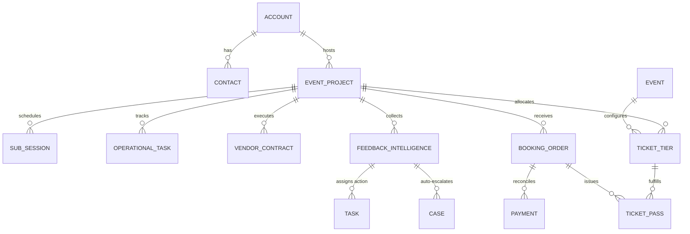

# EpicEventz 360: Project Specification & Architecture Document

> **Project Name:** EpicEventz 360  
> **Repository:** [https://github.com/des2yapath/EpicEventz](https://github.com/des2yapath/EpicEventz)  
> **Platform:** Salesforce Core (Apex, Lightning Web Components, Flow/Triggers, REST)  
> **Documentation Version:** 1.0 (Executive Release)

---

## 1. Project Statement

### The Problem
Live entertainment and enterprise conference operations suffer from severe architectural fragmentation:
* **Front-of-House (Attendee Experience):** Ticketing engines crash during high-velocity burst drops, oversell limited inventory due to race conditions, and lack real-time turnstile validation, causing gate fraud (screenshot/duplicate barcode entry).
* **Back-of-House (Operations & Production):** Vendor contracts, budget allocations, stage sub-sessions, and logistics tasks are trapped in disconnected spreadsheets, causing budget overruns and operational miscommunication.
* **Customer Service Gap:** Disgruntled attendees leaving negative reviews online are only noticed days later, resulting in brand damage and lost customer lifetime value.

### The Mission
**EpicEventz 360** unifies front-of-house attendee experiences with back-of-house event production operations on **Salesforce Core**, delivering high-concurrency ticket reservations, turnstile duplicate check-in protection, real-time budget rollups, and an autonomous "Hero" service recovery loop that turns dissatisfied attendees into retained advocates before they leave the venue.

---

## 2. Requirements

### Functional Requirements
* **FR-01: Attendee Discovery & Search:** Attendees can browse events by category, city, or keyword with real-time responsive client-side filtering and debounced SOSL fallback.
* **FR-02: Dynamic Tiered Pricing:** System automatically calculates dynamic price floors (`"Price From ₹X"`), hiding inactive and sold-out tiers.
* **FR-03: Atomic Checkout & Money Ledger:** Purchase transactions must atomically reserve inventory, record financial payments, create booking orders, and issue individualized ticket passes with seat/table allocations.
* **FR-04: Turnstile Gate Validation:** Gate staff can validate passes via unique QR security tokens with sub-second feedback, stamping admittance timestamps and refusing duplicate/cancelled entries.
* **FR-05: Back-of-House Production Management:** Event managers can track multi-vendor contracts, SLA advance payments, remaining balances, stage sub-sessions, and run-of-show operational tasks.
* **FR-06: Autonomous Service Recovery Loop:** 1- and 2-star feedback must be evaluated in real time, auto-generating a High-Priority Support Case and assigning a next-day executive Task to the event manager.
* **FR-07: External Headless Integration:** Third-party web and mobile clients must be able to book orders via a standard JSON Apex REST endpoint.

### Non-Functional Requirements
* **NFR-01: High Concurrency & Zero Overselling:** Support burst-traffic ticket drops without race conditions or overselling limited VIP allocations.
* **NFR-02: Idempotency & Replay Protection:** Flaky mobile connections and double-tapped checkouts must never double-charge customers or duplicate orders.
* **NFR-03: Multi-Tenant Compliance (Governor Limits):** All synchronous transactions must consume < 10% of Salesforce limits (staying well under 100 SOQL queries and 10s CPU limits).
* **NFR-04: Data Privacy & Security (GDPR/SOC2):** Zero plaintext PII (email addresses) stored in diagnostic logs; queries must enforce `WITH USER_MODE`.
* **NFR-05: Code Quality & Coverage:** Enterprise test suite with >= 85% code coverage and 100% pass rate.

---

## 3. High-Level Modules

```
┌────────────────────────────────────────────────────────────────────────┐
│                        EPICEVENTZ 360 ARCHITECTURE                     │
├──────────────────────────┬─────────────────────────────────────────────┤
│ MODULE                   │ RESPONSIBILITIES & ARTIFACTS                │
├──────────────────────────┼─────────────────────────────────────────────┤
│ 1. Consumer Discovery    │ • LWC: eventExplorer                        │
│                          │ • Debounced SOSL, Dynamic Price Floor       │
│                          │ • Detail Drawer with real-time inventory    │
├──────────────────────────┼─────────────────────────────────────────────┤
│ 2. Gate Turnstile Engine │ • LWC: checkinConsole                       │
│                          │ • Domain Service: EevTicketService          │
│                          │ • Single-scan validation & double refusal   │
├──────────────────────────┼─────────────────────────────────────────────┤
│ 3. Inventory & Checkout  │ • Domain Service: EevInventoryService (CAS) │
│                          │ • Domain Service: EevCheckoutService        │
│                          │ • Idempotency key replay protection         │
├──────────────────────────┼─────────────────────────────────────────────┤
│ 4. Back-of-House Ops     │ • Event_Project__c, Vendor_Contract__c      │
│                          │ • Operational_Task__c, Sub_Session__c       │
│                          │ • Formula fields: Budget Variance & Health  │
├──────────────────────────┼─────────────────────────────────────────────┤
│ 5. Hero Recovery Loop    │ • Domain Service: EevFeedbackService        │
│                          │ • NLP sentiment scoring & issue tagging     │
│                          │ • Auto-spawns High-Priority Case & Task     │
├──────────────────────────┼─────────────────────────────────────────────┤
│ 6. Observability & Drift │ • EevLogger (Correlation IDs, PII Masking)  │
│                          │ • Batch: EevInventoryReconciliationBatch    │
├──────────────────────────┼─────────────────────────────────────────────┤
│ 7. Headless API          │ • Apex REST: EevOrderRestResource           │
│                          │ • POST /services/apexrest/epiceventz/v1/... │
└──────────────────────────┴─────────────────────────────────────────────┘
```

---

## 4. Schema (Data Model & Relational Topology)

### Relational Entity-Relationship Diagram (ERD)



### Key Entities & Fields
| Object | Type | Crucial Fields | Relationship Strategy |
| :--- | :--- | :--- | :--- |
| `Account` | Standard | `Commission_Rate__c`, `KYC_Verification_Status__c`, `Bank_Payout_Details__c` | Record Types: `Corporate_Host`, `Vendor_Company`, `Talent_Agency` |
| `Contact` | Standard | `VIP_Tier__c`, Email, Phone | Record Types: `Fan_Attendee`, `Artist_Talent`, `Vendor_Staff` |
| `Event_Project__c` | Custom | `Total_Budget_Allocated__c`, `Total_Contracted_Spend__c` (Rollup), `Budget_Variance__c` (Formula), `Passes_Checked_In_Count__c` (Rollup), `Live_Attendance_Rate__c` (Formula) | Master operational hub |
| `Ticket_Tier__c` | Custom | `Price__c`, `Base_Price__c`, `Total_Inventory__c`, `Sold_Count__c`, `Is_Active__c`, `Sales_Open_At__c` | **Master-Detail** to `Event_Project__c` (reparentable) & `Event__c` |
| `Booking_Order__c` | Custom | `Total_Amount_Paid__c`, `Payment_Status__c`, `Gateway_Transaction_Id__c` | **Lookup** to `Event_Project__c` (Prevents parent row-lock contention) |
| `Ticket_Pass__c` | Custom | `Secure_QR_Token__c`, `Status__c` (Valid/Checked In/Cancelled), `Check_In_Timestamp__c`, `Table_Seat_Assignment__c` | **Lookup** to `Booking_Order__c` & `Ticket_Tier__c` |
| `Vendor_Contract__c` | Custom | `Contract_Amount__c`, `Advance_Paid__c`, `Balance_Due__c` (Formula), `Service_Category__c` | **Master-Detail** to `Event_Project__c` (powers rollups) |
| `Operational_Task__c`| Custom | `Priority__c`, `Status__c`, `Assigned_Team__c`, `Due_Date__c` | Lookup to `Event_Project__c` |
| `Sub_Session__c` | Custom | `Track__c`, `Stage_Location__c`, `Start_Time__c`, `Speaker_Talent__c` | Master-Detail to `Event_Project__c` |
| `Feedback_Intelligence__c`| Custom | `Rating__c`, `Comments__c`, `AI_Sentiment__c`, `Actionable_Issue_Tag__c` | Lookup to `Event_Project__c` & `Contact` |
| `Payment__c` | Custom | `Amount__c`, `Status__c`, `Method__c`, `Idempotency_Key__c`, `Captured_At__c` | Financial Money Ledger |
| `Log__c` | Custom | `Level__c`, `Apex_Class__c`, `Message__c`, `Correlation_ID__c`, `Duration_Ms__c` | Zero-PII Observability |

---

## 5. Technical Approach

### Architecture & Layering
We follow a 4-tier enterprise software architecture:
1. **Presentation Layer (LWC):** Thin reactive components (`eventExplorer`, `checkinConsole`) using Salesforce Lightning Design System (SLDS).
2. **Adapter Layer (Apex Controllers & REST):** `@AuraEnabled` controllers (`EevCheckinController`, `EevEventExplorerController`) and `@RestResource` endpoints (`EevOrderRestResource`) handle input validation and sanitize exceptions.
3. **Domain Service Layer (Pure Business Logic):** Pure, testable Apex domain services (`EevInventoryService`, `EevCheckoutService`, `EevTicketService`, `EevFeedbackService`) containing zero UI code.
4. **Data & Persistence Layer:** Database operations executed in `AccessLevel.USER_MODE` with atomic savepoints.

### Core Algorithmic Techniques
* **Compare-and-Swap (CAS) Concurrency:** In-memory availability verification (`capacity - currentSold >= qty`) followed by conditional atomic updates.
* **UUID Idempotency Check:** Short-circuits duplicate checkout payloads before touching inventory.
* **Cryptographic Token Hashing:** MD5 digest token issuance (`Crypto.generateDigest('MD5', ...)`) for gate passes.
* **Regex PII Anonymization:** Regex masking sanitizes attendee email addresses before persisting to `Log__c`.
* **Eventual Consistency Self-Healing:** Nightly `Database.Batchable` and `Schedulable` jobs reconcile valid pass rows against tier counters.

---

## 6. Challenges Encountered

1. **Race Conditions During High-Traffic Ticket Drops:** Concurrent transactions attempting to reserve the same tier caused overselling when using standard `SELECT` &rarr; `UPDATE`.
2. **Database Row Lock Bottlenecks (`UNABLE_TO_LOCK_ROW`):** Using pessimistic row locks (`SELECT ... FOR UPDATE`) caused 5-second lock timeouts and crashed incoming requests.
3. **Parent Record Locking in Master-Detail Relationships:** In Salesforce, inserting children in a Master-Detail relationship locks the parent record. Linking high-volume `Booking_Order__c` to `Event_Project__c` via Master-Detail froze all simultaneous checkouts.
4. **Duplicate Turnstile Scans (Screenshots / Fraud):** Scalpers reselling identical QR screenshots caused gate disputes.
5. **Network Drops & Replay Double-Charging:** Mobile connection drops after payment gateway capture caused attendees to hit "Pay Now" twice, resulting in duplicate charges.
6. **Compliance Risks from Plaintext PII in System Logs:** Raw attendee email addresses in diagnostic error traces violate GDPR and SOC2 compliance.
7. **Master-Detail Non-Reparentable Update Restrictions:** Adding a Master-Detail field to an existing child object made the field non-writeable during upsert operations.

---

## 7. Workarounds & Engineering Solutions

| Challenge | Workaround / Engineering Solution | Code Implementation |
| :--- | :--- | :--- |
| **Race Conditions & Row Locks** | Replaced `FOR UPDATE` with **Compare-and-Swap (CAS)** optimistic concurrency control. Check availability in memory and execute atomic conditional updates. | [`EevInventoryService.cls`](file:///force-app/main/default/classes/EevInventoryService.cls) |
| **Parent Lock Contention** | Decoupled `Booking_Order__c` from `Event_Project__c` using a **Lookup relationship** instead of Master-Detail, eliminating parent locks during mass checkouts. | `Booking_Order__c.Event_Project__c` |
| **Gate Duplicate Scans** | Minted unguessable MD5 hash tokens and implemented **atomic state mutation** (`Status__c = 'Checked In'` and timestamp stamp on first scan; immediate rejection on scan 2). | [`EevTicketService.cls`](file:///force-app/main/default/classes/EevTicketService.cls) |
| **Payment Double-Charging** | Implemented **distributed idempotency keys** on `Payment__c`. Existing keys short-circuit and return prior confirmations with `isReplay = true`. | [`EevCheckoutService.cls`](file:///force-app/main/default/classes/EevCheckoutService.cls) |
| **PII in Diagnostic Logs** | Built regex-based email masking (`maskPII`) in `EevLogger` to convert `user@domain.com` into `u***r@domain.com` with unique correlation IDs. | [`EevLogger.cls`](file:///force-app/main/default/classes/EevLogger.cls) |
| **Master-Detail Reparenting** | Enabled `<reparentableMasterDetail>true</reparentableMasterDetail>` in metadata and guarded data seeder assignments (`if (tier.Id == null)`). | `Ticket_Tier__c.Event_Project__c` |
| **Inventory Counter Drift** | Deployed a nightly schedulable batch job (`EevInventoryReconciliationBatch`) that audits issued passes and repairs counter drift back to true ledger state. | [`EevInventoryReconciliationBatch.cls`](file:///force-app/main/default/classes/EevInventoryReconciliationBatch.cls) |

---

## 8. Future Scope & Roadmap

1. **Offline-First Gate Scanner Mobile App (Salesforce Mobile SDK):** Enable turnstile check-in scanning on low-connectivity mobile devices with local SQLite caching and background sync.
2. **Native Salesforce Einstein Generative AI Integration:** Replace keyword heuristic sentiment analysis with Einstein Prompt Builder and LLM classification to auto-generate personalized recovery emails.
3. **Dynamic Surge & Early-Bird Pricing Engine:** Implement automated price adjustments based on real-time sales velocity and venue capacity thresholds.
4. **Web3 / NFT Soulbound Attendance Badges:** Automatically issue cryptographic Proof of Attendance Protocols (POAP) to attendee wallets upon gate check-in.
5. **Vendor Procurement Reverse-Auction Bidding Portal:** Build an Experience Cloud portal where certified stage, lighting, and catering vendors submit competitive bids against `Operational_Task__c` requirements.
6. **Multi-Currency Global Payment Gateway Integration:** Expand headless REST API to support Stripe, PayPal, Razorpay, and Apple Pay with automated currency conversion into the organizer's base currency.
